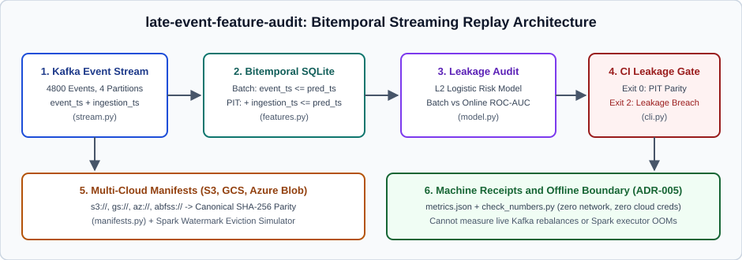
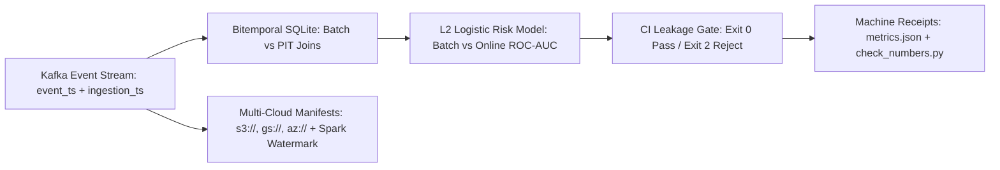
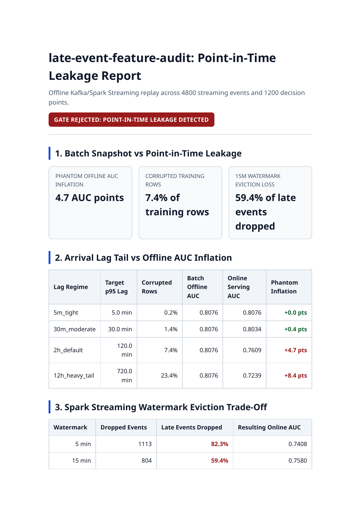
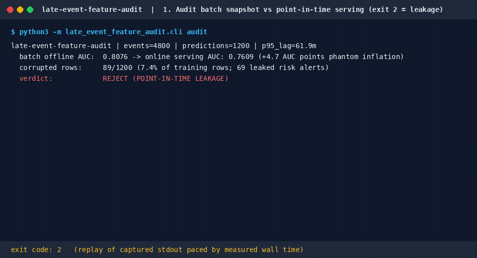

# late-event-feature-audit

**Detects silent point-in-time feature leakage caused by late-arriving Kafka and Spark Streaming events across AWS S3, Google Cloud Storage, and Azure Blob manifests.**

## The structural impossibility

A batch warehouse query over current table state has no edge recording when late-arriving streaming events actually landed, so offline training features silently leak future information that online serving never had at prediction time. Four concrete questions this tool answers that a standard batch backfill cannot:

1. How many offline ROC-AUC points evaporate the moment a batch-trained model is scored against honest point-in-time online features?
2. How fast do corrupted training rows and phantom AUC lift grow as p95 arrival lag widens from 5 minutes to 12 hours?
3. When you enforce a tight Spark Structured Streaming watermark to bound state memory, what share of valid late events gets silently dropped?
4. Do your AWS S3 (`s3://`), Google Cloud Storage (`gs://`), and Azure Blob (`az://`) event manifests produce byte-identical point-in-time feature inputs?

## The uncomfortable numbers

* **Tight Spark Streaming watermarks drop most late events:** Enforcing a 15-minute watermark to control state memory results in **59.4% of late events dropped** (804 of 1353 late events evicted), and a 5-minute watermark drops 82.3% while pulling online ROC-AUC down to 0.7408.
* **Phantom offline AUC inflation at 2-hour lag:** Across **4800 streaming events** and 1200 decision points, naive batch-snapshot SQL corrupts **7.4% of training rows** and inflates offline ROC-AUC by **4.7 AUC points** (`0.8076` offline collapses to `0.7609` online).
* **Heavy-tail arrival lag doubles the illusion:** Under a 12-hour p95 lag regime, 23.4% of rows are corrupted and phantom lift reaches **8.4 points at 12h** (`0.8076` offline vs `0.7239` online).

Verified by **74 tests** at **90%+ line coverage** across **3 cloud providers**; every published figure is re-measured from code and verified against prose by `tools/check_numbers.py` in CI.

## Quickstart

Prerequisites: Python 3.10+, `numpy`, `scipy`.

```bash
git clone https://github.com/LollaVaishnavi/late-event-feature-audit.git
cd late-event-feature-audit
python3 -m pip install -e .

# Reproduce the headline point-in-time leakage rejection (exits 2 on leakage breach)
PYTHONPATH=src python3 -m late_event_feature_audit.cli audit

# Measure Spark Streaming 15-minute watermark eviction loss
PYTHONPATH=src python3 -m late_event_feature_audit.cli watermark --watermark 15

# Run lint, full test suite, all four experiments, and machine-checked receipts offline
make verify
```

## 1. Batch snapshot vs point-in-time leakage (Experiment 01)

| Feature Join Mode | SQL Predicate | Corrupted Rows | Offline / Online ROC-AUC |
| --- | --- | ---: | ---: |
| Naive Batch Snapshot | `event_ts <= prediction_ts` | 89 / 1200 (7.4% of training rows) | 0.8076 (inflated) |
| Batch Model on Online Serving | Trained on batch, scored on PIT | 69 leaked risk alerts missing online | 0.7609 (-4.7 AUC points) |
| Honest Point-in-Time (`PIT`) | `event_ts <= pred_ts AND ingestion_ts <= pred_ts` | 0 / 1200 (0.0%) | 0.7609 (honest) |

## 2. Arrival lag tail vs phantom AUC inflation (Experiment 02)

| Lag Regime | Target p95 Lag | Corrupted Rows | Batch Offline AUC | Online Serving AUC | Phantom Inflation |
| --- | ---: | ---: | ---: | ---: | ---: |
| `5m_tight` | 5 min | 0.2% | 0.8076 | 0.8076 | +0.0 pts |
| `30m_moderate` | 30 min | 1.4% | 0.8076 | 0.8034 | +0.4 pts |
| `2h_default` | 120 min | 7.4% | 0.8076 | 0.7609 | +4.7 pts |
| `12h_heavy_tail` | 720 min | 23.4% | 0.8076 | 0.7239 | +8.4 pts |

## 3. Spark Streaming watermark eviction trade-off (Experiment 03)

| Watermark Cutoff | Dropped Events | Late Events Dropped | Resulting Online ROC-AUC |
| ---: | ---: | ---: | ---: |
| 5 min | 1113 | 82.3% | 0.7408 |
| 15 min | 804 | 59.4% | 0.7580 |
| 60 min | 222 | 16.4% | 0.7632 |
| 360 min | 4 | 0.3% | 0.7609 |

| What widening watermark from 15m to 60m costs | What it buys |
| --- | --- |
| 4x longer streaming state retention window in Spark Structured Streaming | Cuts late-event eviction from 59.4% to 16.4% and lifts online ROC-AUC from 0.7580 to 0.7632 |

## 4. Multi-cloud manifest parity across S3, GCS, and Azure Blob (Experiment 04)

| Cloud Provider | Storage Root | Partitions | Events | Canonical SHA-256 | Parity |
| --- | --- | ---: | ---: | --- | --- |
| `aws_s3` | `s3://ecommerce-events-prod` | 4 | 4800 | `17aa35aa3de9406e` | Match |
| `gcp_gcs` | `gs://ecommerce-events-prod` | 4 | 4800 | `17aa35aa3de9406e` | Match |
| `azure_blob` | `az://ecommerce-events-prod` | 4 | 4800 | `17aa35aa3de9406e` | Match |

## Bugs the measurement found

1. **Impossible clock-skew events (`ingestion_ts < event_ts`) silently entered SQLite:** Boundary testing revealed that malformed events claiming arrival before occurrence were accepted without error, distorting bitemporal SQL joins. Fixed in commit `fea09e6` by rejecting `ingestion_ts_min < event_ts_min` before database load and pinned by `test_extract_features_rejects_impossible_ingestion_before_event_timestamp`.
2. **Even zero-late-rate streams retain sub-2-minute transit lag:** Testing `late_event_rate=0.0` initially assumed 0 corrupted rows, yet 4 of 1200 predictions (0.3%) still landed inside the 0.1-to-2.0 minute broker transit window, confirming that real streaming systems never achieve zero arrival skew.

## Architecture





## Evidence

Section-verified screenshot of the HTML audit report generated by `tools/capture_screenshots.py` (which verifies CSS rule completeness and asserts WCAG AAA verdict badge contrast of 8.31:1):



Replay of captured CLI stdout paced by measured wall time (`tools/record_demo.py`; see [docs/video/manifest.json](docs/video/manifest.json) for commands, exit codes, and durations, and [docs/video/demo.mp4](docs/video/demo.mp4) for full quality):



## The corpus and hard cases

The deterministic generator (`src/late_event_feature_audit/stream.py`, seed `20260619`) builds 4800 streaming events across 4 Kafka partitions and 120 accounts over a 14-day horizon. Hard cases include delayed `gateway_risk_alert` webhooks whose `event_ts` precedes checkout while `ingestion_ts` arrives under a log-normal lag tail, plus sub-2-minute broker transit jitter on normal events.

## What this cannot measure

Full boundary recorded in [ADR-005](docs/adr/ADR-005-offline-replay-boundary-and-unmeasured-broker-effects.md):

* **Kafka broker rebalance pauses and replication lag:** Live partition reassignments create transient lag spikes requiring real broker telemetry.
* **Spark Structured Streaming executor memory pressure:** RocksDB state-store sizing under high key cardinality requires cluster profiling.
* **Cloud object-store listing latency and egress billing:** Manifest normalization verifies schema and digest parity across S3, GCS, and Azure Blob, not live network throughput.

## Layout, exit codes, and reproduction

```text
late-event-feature-audit/
├── .github/workflows/ci.yml        # 3-Python matrix, ruff, pytest, coverage floor, receipts
├── docs/adr/                       # Five architecture decision records
├── docs/evidence/                  # Committed SVG diagram, report screenshots, manifests
├── docs/experiments/               # Re-measured JSON outputs from all four experiments
├── docs/video/                     # Captured stdout replay (demo.mp4, demo.gif, manifest.json)
├── experiments/                    # Four standalone experiment scripts
├── src/late_event_feature_audit/   # config, stream, manifests, features, model, report, cli
├── tests/                          # 74 property tests
└── tools/                          # collect_metrics.py, check_numbers.py, evidence generators
```

CLI exit codes:

* `0`: Point-in-time parity verified within policy thresholds.
* `2`: Point-in-time leakage or AUC inflation breached the CI gate.
* `1`: Invalid configuration, unsupported cloud URI scheme, clock-skew error, or runtime failure.

Make targets: `make lint`, `make test`, `make experiments`, `make receipts`, `make evidence`, and `make verify`.

## Tech stack and ADRs

| Technology | Role | Why chosen here |
| --- | --- | --- |
| Python 3.10 to 3.12 | Core runtime | Matches enterprise data/ML stacks and 3-version CI matrix |
| SQLite (`sqlite3`) | Bitemporal feature store | Runs batch-snapshot vs point-in-time SQL joins offline with zero credentials |
| Kafka & Spark Replay | Event-log & watermark simulator | Models partitioned offsets, log-normal lag tails, and watermark eviction offline |
| Multi-Cloud Manifests | `s3://`, `gs://`, `az://` adapter | Normalizes AWS, GCP, and Azure Blob partition contracts with SHA-256 parity |
| `numpy`, `scipy` | L2 logistic model & exact ROC-AUC | Deterministic Mann-Whitney AUC and L-BFGS-B training without thread variance |

Architecture Decision Records:

1. [ADR-001: SQLite and Partition Manifests Over Live Kafka Brokers and Cloud Buckets](docs/adr/ADR-001-sqlite-and-manifests-over-live-kafka-and-cloud-buckets.md)
2. [ADR-002: Bitemporal (`event_ts`, `ingestion_ts`) Joins Over Batch Snapshots](docs/adr/ADR-002-bitemporal-ingestion-time-join-over-batch-snapshot.md)
3. [ADR-003: Spark Streaming Watermark Cutoff Trade-Off (Completeness vs Freshness)](docs/adr/ADR-003-watermark-cutoff-completeness-vs-freshness-tradeoff.md)
4. [ADR-004: Unified Multi-Cloud Partition Manifest Contract (`s3://`, `gs://`, `az://`)](docs/adr/ADR-004-multicloud-uri-manifest-contract-s3-gcs-azure.md)
5. [ADR-005: Offline Replay Boundary and What This Repository Cannot Measure](docs/adr/ADR-005-offline-replay-boundary-and-unmeasured-broker-effects.md)

## The Pivot and future work

* **Intentionally out of scope:** Live distributed Apache Kafka consumer groups and Spark Structured Streaming state-store deployment on Databricks or Dataproc. **Trigger condition:** Add it only after offline bitemporal auditing runs in feature-store CI and production Kafka topics stamp immutable `ingestion_ts` headers alongside `event_ts`.
* **v2 priorities:**
  * Parquet/Delta Lake transaction-log reader mapping commit timestamps directly to `ingestion_ts`.
  * Per-feature leakage attribution ranking which individual columns drive phantom AUC lift.
  * Adaptive watermark recommendation optimizing online recall under a fixed state-memory budget.
  * First metric to watch in production: daily **99th-percentile event-to-ingestion lag** by Kafka topic partition.
